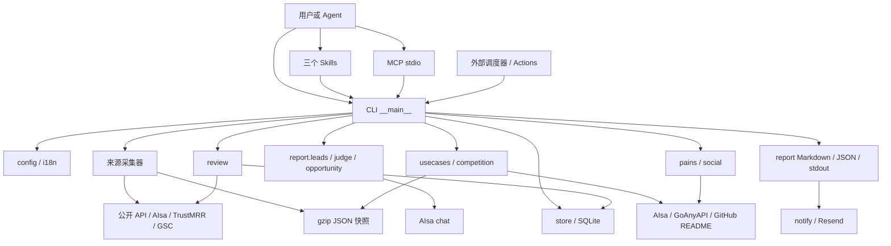
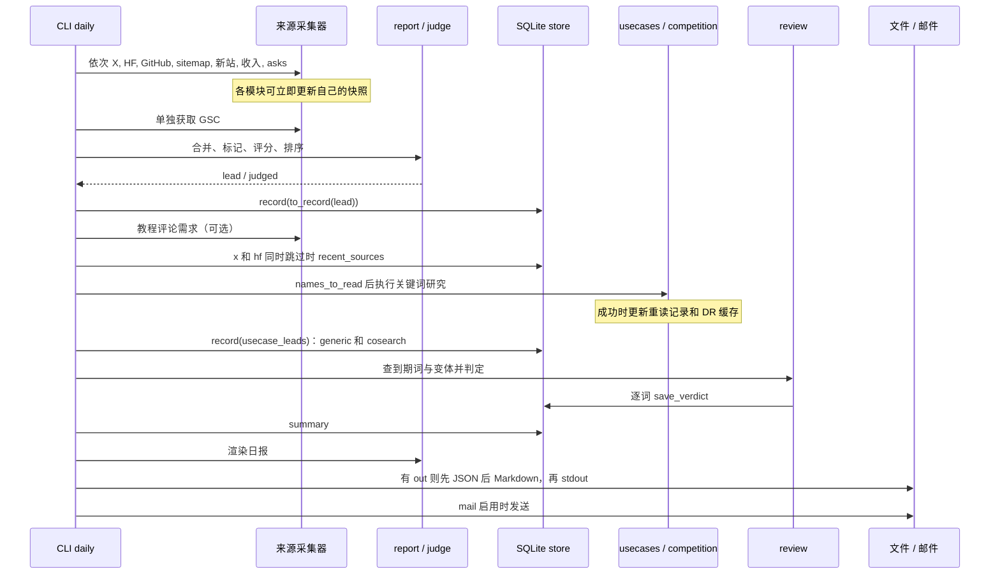
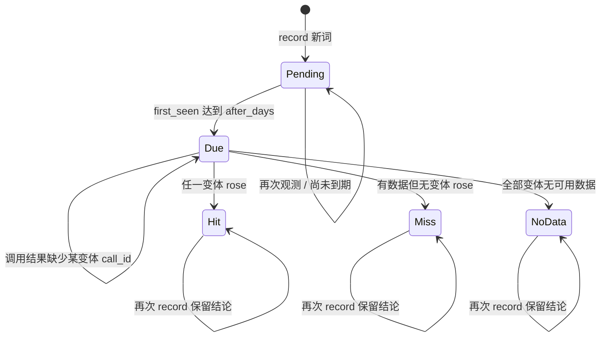

# 新词雷达架构设计

文档 1.0；描述产品 0.4.0 现状；基线 `e2d33c335b7aface39e6c0eed29e61df5b5ff684`；2026-10-16。
对应：[PRD](../product/PRD.md)、[证据矩阵](TRACEABILITY.md)。这是现有设计的逆向说明，不是已批准的重构方案。

## 1. 系统边界与技术选择

当前系统是一个同步执行的 Python 包，核心只依赖标准库，Python 版本要求 ≥3.10。状态保存在调用者选择的本地目录；GitHub Actions 可作为外部调度器。MCP 为 stdio 适配，复用同一 CLI/领域函数，没有独立服务端数据库。

从仓库运行用 `python -m radar`；通过 pyproject 安装后包名映射为 `new_term_radar`，命令为 `new-term-radar` 和 `new-term-radar-mcp`，避免与其他 PyPI radar 包冲突。`mcp`、`markdown` 分别为 MCP 与邮件可选依赖；授权脚本额外需要 google-auth-oauthlib。



图中的分层是阅读视图，并非代码实施了严格 clean architecture。`report.py` 不只有渲染：它合并线索、调用名称评分并决定入库集合；MCP 直接依赖 CLI；asks 复用 usecases.volumes 和 competition.assess。文档遵循这些实际所有权，不凭空增加 repository/service/protocol 层。

## 2. 模块与语义所有者

| 模块 | 负责的事实 / 规则 | 不负责的职责 |
|---|---|---|
| [__main__](../../radar/__main__.py) | 参数、运行顺序、跳过、错误封装、文件与邮件完成路径 | 不统一校验全部配置、不提供事务工作流 |
| [config](../../radar/config.py) / [i18n](../../radar/i18n.py) | 默认配置、浅合并、known 匹配、语言文本 | 不存密钥；无 schema 迁移 |
| [sources](../../radar/sources.py) / [terms](../../radar/terms.py) | X/HF 采集、名字提取、词频排序 | 不证明全网首次出现 |
| [breakout](../../radar/breakout.py) / [sitemaps](../../radar/sitemaps.py) / [new_sites](../../radar/new_sites.py) | 各信号采样、判定与快照 | 不做跨源实体消歧 |
| [revenue](../../radar/revenue.py) / [asks](../../radar/asks.py) | 收入/求助筛选、来源内去重 | 不保证都通过最终名称门槛 |
| [report](../../radar/report.py) / [judge](../../radar/judge.py) / [opportunity](../../radar/opportunity.py) | 合并、名称评分、规则标记、展示、入库投影 | 不是仅有纯展示逻辑 |
| [usecases](../../radar/usecases.py) | 证据、用途提词、相关查询、趋势形状、规模与基础建议 | 不在按需入口写 leads |
| [competition](../../radar/competition.py) | 首页结构、DR/KD、竞争裁决与建议降级 | 不证明某位置一定能获得排名 |
| [review](../../radar/review.py) / [store](../../radar/store.py) | 复盘规则；线索和结论的数据库真源 | 不提供每次运行全量事件日志 |
| [pains](../../radar/pains.py) / [social](../../radar/social.py) | 评论/帖子采集与痛点聚类 | 不直接生成 daily 机会表或写 leads |
| [aisa](../../radar/aisa.py) / [goanyapi](../../radar/goanyapi.py) | 外部协议、凭证、响应与费用适配 | 不统一产生产品级健康状态 |
| [gsc](../../radar/gsc.py) | 站点 OAuth、曝光窗口对比 | 不进入名称线索库 |
| [snap](../../radar/snap.py) / [notify](../../radar/notify.py) | gzip JSON 文件读写；邮件格式/发送 | 无全局锁、重放去重、跨文件提交 |
| [mcp_server](../../radar/mcp_server.py) | 工具注册、stdio、线程桥接、捕获 stdout | 无独立任务队列/调度器 |

## 3. 入口与公开契约

### 3.1 CLI

| 命令 | 输入 | 输出 | 状态副作用 |
|---|---|---|---|
| sources | config/state/skip/out/mail | 有名称或错误时 Markdown；否则仅安静状态行 | 来源快照、筛选后 leads |
| daily | config/state/skip/out/强制周信号/mail | Markdown；有 out 时同 stem JSON | 采集快照、leads、机会重读记录、DR 缓存、复盘结论 |
| keywords | 名字列表、可重复 NAME=OWNER/REPO、json/out | 关键词表或结构化结果 | 不更新 leads/机会重读记录；可更新 DR 缓存 |
| leads | days/state/json | 历史及按信号复盘统计 | connect 可新建目录/空库；不加载 config、不处理 out |
| pains | 词、可重复 extension、json/out | 痛点 Markdown/JSON | 本路径不写 leads 或采集快照 |
| mcp | 专用首参数分支 | stdio 协议 | 取决于工具 |

`--skip` 精确集合为 x,hf,breakout,sitemaps,newsites,revenue,asks,gsc,review,judge,usecases,tutorials；未知值经 argparse 拒绝。skip 的实际作用取决于命令：例如 keywords 不因 `--skip usecases` 而关闭。`--new-sites`、`--revenue`、`--asks` 分别只强制对应周信号。

先完成 argparse，再读取配置；config 缺失抛 SystemExit。state 目录在采集路径前创建。运行编排的 `run(fn, skip)` 只捕获 Exception，返回 `error`（异常类型与压缩后最多 160 字符）或 `skipped`，不捕获 SystemExit/KeyboardInterrupt，且只保护被显式包裹的调用。

### 3.2 MCP

模块先尝试 MCP 2.x 的 MCPServer，ImportError 时回退 MCP 1.x FastMCP。`RADAR_CONFIG` 默认 `./config.json`，`RADAR_STATE` 默认 `./state`；路径相对进程工作目录。

| 工具 | 参数 | 返回字段 | 行为 |
|---|---|---|---|
| recent_leads | days=7 | leads, hit_rates | 同 cli.kept_leads；无需配置/外部 API |
| keyword_table | names, repos={} | table_markdown, rows, incomplete, cost_usd | await asyncio.to_thread；同按需机会研究，最多前 8 个去重名字 |
| run_radar | command=sources, skip=[] | report_markdown, wrote_report | 只允许 sources/daily；临时文件收集报告，再销毁临时目录；状态目录保留 |

`incomplete` 只看 posts_error、related_errors、country_errors、competition_errors；不包括来源未启用、no_evidence、筛选失败、无数据、部分静默缺项。整步异常会抛出而非统一返回 incomplete。`cost_usd` 对已汇总微美元取三位小数，不是完整账单。run_radar 不返回 daily JSON，也不保证 wrote_report=true 就数据完整。

`_quiet` 使用 redirect_stdout 捕获 CLI 文本，避免破坏 stdio；异步工具把同步任务放进线程，不等于底层 HTTP 可取消。当前没有把工具取消传递给工作线程的回滚机制。

### 3.3 报告数据形状

daily JSON 顶层：`leads,x,hf,breakout,sitemap,newsite,revenue,ask,gsc,review,summary,keywords`。这是运行结果快照；与 Markdown 不严格同构，judge/record/recent_sources/tutorials 没有全部独立序列化。JSON 与 Markdown 分开写入，可能只成功其中之一。

来源块通常是 `{terms, ...source_stats, cost_micros?}`，失败可能为 `{error}`，跳过为 `{skipped:true}`，GSC 关闭为 `{off:true}`，收入缺 key 另有 `no_key:true`。这是当前隐式 dict 协议，没有 schema version 或强类型校验；使用者应检查字段存在性，不把缺失一律视为零。

候选行关键字段：`term,kinds,signals,examples,variants,posts,known,named?,repo?,about?,format,one_click`。`kinds` 是来源机器标识，`signals` 是人类可读说明；入库后字段映射不同，见下一节。

机会行关键字段：`term,phrase,kind(name/generic),names,brand,evidence,source?,volume?,month?,no_data,new?,base?,peak?,peak_day?,started?,now?,momentum?,peak_vs?,bench_level?,per_day?,decision,trend_geo?,competition?,demoted?`。缺字段与 null 都可能出现；Trends 全零时可只有 no_data=true 而无 now/new/peak_day。机器值不随中文报告翻译。

## 4. 核心调用链与写入时序

### 4.1 daily



这是顺序调用，不是并行 fan-out。各 run 封装能使部分步骤失败后继续，但 `report.leads`、数据库 connect、最终渲染/写盘等在封装外。`record(usecase_leads(...))` 的 run 返回值未被保存进 extra，故该入库失败可能未显示在报告。不存在整次运行“全部成功才提交”的约束。

近期 X/HF 回读使用 last_seen ≥ yesterday 的 **日期字符串**，最多 20 条，先按词的日期/词序排序后筛 X/HF；不是精确最近 24 小时，也没有保存原始 repo、variant 等全部上下文。旧词因其他来源更新 last_seen 后仍可能回到近期列表。

### 4.2 sources 与按需入口

sources：采集 X/HF → report.leads → store.record → 名称存在或错误存在则 `_finish`。即使最后没有报告，采集快照可能已经更新；复跑只看到增量，不能假设可以重建同一份报告。有旧 out 文件时，安静路径不删除它；调度器需使用每次新的输出路径或自行管理旧文件。

keywords：清理小写名字 → usecases.run(on_request=True) → 渲染。该模式从空 seen 开始，跳过 daily 重读记录写入；不调用 store.record。`leads` 是本地库查询；`pains` 是独立采集/聚类链，不复用关键词机会决策。

## 5. 业务算法的技术契约

精确产品阈值见 PRD F02–F12；这里说明实现影响。

- `report.leads` 是词汇合并与展示优先级所有者，键为原 term 字符串；名字概率归 judge；媒体/one_click 标记归 opportunity；两者不是相同评分。
- `report.to_record` 先取通过名称过滤的前 20 行，再排除 known。模型失败造成未评分行时 `report.named` 将缺分默认通过，但排序缺分按 0 处理；已经评分的低分行仍会排除。部分失败时不等于所有词都变成未评分。
- `usecases.names_to_read` 另有 READ_KINDS 与 0.8 阈值；未评分仍通过。daily 的输入包含已筛选 lead 及近期来源；`due` 在此基础上还会选 seen 中到期一次重读名字。
- `usecases.evidence` 逐名字单请求抓 X，避免工具路由长批次；README 失败返回空文本。`propose` 无证据返回空候选，但其 chat 异常不在名字级捕获，可能使整步 usecases 失败；`screen` 异常则返回原候选，不强制剔除。
- `relevant` 对缺相关性默认 1.0；相关查询最多 12 个候选/名字；`other_names` 要求新且 rising，排除同词族及本次其他名字等，最多 5 个/名字。语义判断仍依赖模型，不是注册实体库。
- `usecases.shape` 的上涨按窗口内过线点数，started 再回溯峰值前连续一段。不能把两者统一描述为“连续上涨两/三天”。
- 国家序列用于 shape；`own_per_day`、`size` 的规模仍用 AIsa 全球序列及月搜。`bench_daily` 使用有月搜至少 1000 的通用词反推基准量并取中位数；无校准时名字可能没有 per_day。推算用每月 30 天，非精确自然月。
- `competition.verdict` 将部分未知组合归 crowded；assess 只在拿到页面对象时附竞争，不把所有外部失败都变成 unknown。dr dict 非空但该词无已知评分时 weak 可能为 0；DR 覆盖不是完整首页覆盖保证。
- `review.rose` 使用峰值判定而非 shape 的持续点数；`first_rise` 从整个给定序列搜索，故 lead_days 可为负。call_id 缺失保持 due；存在但 tasks/序列空时可能保存 no_data。

## 6. 存储与生命周期

### 6.1 SQLite

默认 `state/radar.db`。唯一表 `leads`，无单独 event/run/account 表，无显式 schema version/migration runner。

| 列 | SQLite 类型 / 默认 | 含义 |
|---|---|---|
| term | TEXT PRIMARY KEY | 词级唯一键，入库不额外做标准化 |
| first_seen / last_seen | TEXT NOT NULL | 本机 date.today 的 ISO 日期，首次不可变、复现更新 last_seen |
| signals | TEXT NOT NULL DEFAULT '[]' | 来源 kinds 的 JSON 数组，并集合并排序 |
| notes | TEXT NOT NULL DEFAULT '[]' | 报告 signals 文本合并，保留最后 10 条 |
| named | REAL nullable | 最近传入非空名称分数，缺失时保留旧值 |
| variants | TEXT NOT NULL DEFAULT '[]' | 搜索变体 JSON 数组，合并去重 |
| reviewed_at | TEXT nullable | 已复盘日期，也是 pending 判断依据 |
| verdict | TEXT nullable | 代码约定 hit/miss/no_data，无数据库 CHECK |
| lead_days | INTEGER nullable | 复盘提前天数，外部 leads 返回 days_ahead |
| trends | TEXT nullable | 各变体判定数据 JSON，不是所有来源原始历史 |

注意：库中 `signals` 是来源 kinds，库中 `notes` 才是人类说明；不能直接按 daily JSON 的同名字段读取。leads 查询返回 name_score 而非库中 named，且只返回 notes 最后一条。

`record` 对传入行循环查询/插入或更新，最后 commit；返回处理行数，不是新增行数。`save_verdict` 每词一次 commit。成功调用内部有 SQLite 事务提交，但快照、多个 record 调用、各个 verdict 和输出文件不在同一事务。连接没有显式 close 上下文；多进程并发及失败事务清理由现有 sqlite/进程生命周期约束，不能声称系统级 exactly-once。



Due 是 SELECT 计算出的资格，不是持久化状态列；图中的终态是普通自动流程的终态，数据库没有禁止维护者手动修改。缺 call_id 会重试，但误返回空序列后的 NoData 不会由常规流程重试。

### 6.2 gzip JSON 快照与缓存

`snap.load`：不存在返回 None，存在但损坏直接抛异常。`snap.save`：创建父目录并直接覆盖压缩文件，无临时文件 rename、版本、校验和或锁。

| 路径（相对 state） | 所有者 / 内容 | 生命周期 |
|---|---|---|
| x_vocab.json.gz | sources；term→最近观测日期 | 成功拿到帖子时保存并裁到最近 60 天；词表来自取回帖子 |
| hf_top.json.gz / hf_spaces_top.json.gz | sources；上次模型/Space 前 100 ID | 每个非空列表成功后独立覆盖 |
| gh_stars.json.gz | breakout；full_name→star 数 | 有搜索仓库时覆盖 |
| gh_flagged.json.gz | breakout；repo→首次触发日 | 30 天标记窗口 |
| sitemaps/站点名.json.gz | sitemaps；归一后的排序 URL | 每站非空成功后覆盖；失败保留 |
| new_sites.json.gz | new_sites；domain→首次观测日 | 有路由返回数据时保存，当前无裁剪 |
| revenue.json.gz | revenue；slug→cents/day | 有结果时保存；当前无裁剪 |
| asks.json.gz | asks；phrase→首次观测日 | 用于 again 标记；当前无裁剪 |
| usecases.json.gz | usecases；name→first/runs | 非按需成功研究后更新；仅保存 first 最近 30 天 |
| ratings.json.gz | competition；domain→dr/day | 读时保留未满 30 天项并补查；按需模式也可更新 |

重读记录仅保存名字、first 与 runs，不保留 repo/收入介绍。due 的第二次研究若输入缺少对应 repo 上下文，证据能力可能变化。新名字持续占满 per_day 时，二次读取会延后；30 天裁剪和来源再次出现使“永久最多两次”不成立。

HF 两个列表独立落盘，第二次抓取失败时第一份快照可能已更新；其他采集器也可能在日报中途失败前保存状态。丢失快照会重建基线，丢失 DB 会丢 first_seen/复盘史；只恢复 DB 不等于恢复整个采集状态。

## 7. 配置、凭证与外部协议

### 7.1 配置生效链

`--config` → config.load(path) → DEFAULTS 顶层读取/一级 dict 浅合并 → `_dir=配置父目录` → 设置进程全局语言与 STOP → 各模块最终消费。字典内更深层项不递归合并。`--skip judge` 将本次 judge.model 置空；不会顺带关闭用途研究模型。

示例不等于全量默认：示例指定 35 个 X 账号、多站 sitemap、两个新站查询和 usecases 参数；asks/pains/tutorials、多项窗口与重读阈值来自 DEFAULTS。topics/known/stop 的语义与完整默认值应查源码，而非把示例账号列表当产品固定清单。

| 配置组 | 关键默认值 | 最终消费点 |
|---|---|---|
| lang / topics / known_terms / stop_words | en / 空 | config.load、report.topic_lines、config.known、terms.add_stop |
| judge | gpt-4.1-mini / min_score=0.5 | judge.score、report.named |
| breakout | window_days=14,min_stars=300,velocity_min=200,delta_min=400 | breakout.breakouts/score |
| new_sites | weekday=0,window_days=90,min_etv=1000,min_keywords=20 | cmd_daily 周条件、new_sites._calls/keep |
| usecases | per_day=5,recheck_days=3,trends_max=10,min_volume=50,min_daily=300,benchmark=gpts | due/run/measure/decide |
| usecases 国家增强 | related/country_trends=true,related_geo=US,country_min_volume=1000,country_max=8 | split_related/country_series/measure |
| competition | max_rows=8,weak_dr=30,location_code=2840 | competition.assess；asks 也调用 |
| revenue / asks | weekday=0，分别 max_leads=10/12 | cmd_daily 及各采集器 |
| review | after_days=14,per_day=5 | store.due、review.plan_calls |
| pains / tutorials | extensions=5,review_pages=2,max_stars=3,videos=3 / max_leads=3 | pains.run/chrome/tutorial_asks |
| gsc | 空 | gsc.gsc_new |

这张表是关键参数导航，完整配置以 DEFAULTS 为准。location_code=2840 是代码默认传值；报告全球/国家形状与月搜来源的地域口径不自动一致。负数、非法日期/正则、过大的 days/per_day 等未系统校验，可能变为 Python 切片语义、异常或非预期工作量。

### 7.2 凭证来源与边界

| 服务 | 凭证/地址来源 | 使用者 |
|---|---|---|
| AIsa | AISA_API_KEY 优先；否则 ~/.aisa/key，再 tokens.json accessToken | 工具路由与 chat 共用 key |
| AIsa 端点 | AISA_ROUTER_BASE_URL / AISA_API_BASE_URL，导入模块时取值 | aisa.ROUTER / CHAT |
| GoAnyAPI | GOANYAPI_API_KEY；GOANYAPI_BASE_URL 导入时取值 | related/国家走势/DR/供给/Chrome/视频搜索 |
| GitHub | GITHUB_TOKEN 优先，否则 GH_TOKEN；可不配 | breakout、usecases._readme |
| TrustMRR | TRUSTMRR_API_KEY | revenue |
| GSC | config._dir 下 token_file 优先，否则 GSC_TOKEN_JSON | refresh token 换 access token，只读查询 |
| Resend | RESEND_API_KEY、EMAIL_FROM、RADAR_EMAIL_TO | notify.send |

GSC 授权脚本将 token 写当前工作目录的 gsc_token.json；部署者需确保与配置父目录一致。默认 gitignore 排除 config、state、OAuth 凭证、报告、.env；这不是加密或访问控制。自定义输出名/状态路径、CI artifact、错误消息仍可能包含受限数据，不能一概当作可公开内容。

### 7.3 超时、重试与费用

| 适配器 | 实现行为 |
|---|---|
| AIsa router | call 每批最大 20；call_all 默认每批 5 个、串行；240s 超时；请求失败不自动重试，防重复计费；单项失败从 dict 缺席 |
| AIsa chat | 90s；temperature=0；各场景有自己的 token 上限；不返回已计费 token 到总额 |
| GoAnyAPI | 90s；最多 2 次；HTTP <500 不重试，部分网络/解析错误和 5xx 可重试；code 非 ok 抛异常 |
| sitemap | 40s；最多 3 次；退避 10/20s，按配置 pause 间隔；部分旧快照保留 |
| GitHub / HF | GitHub 30s，HF 40s；此处没有统一重试器 |
| TrustMRR | 40s；请求之间 6.5s，最多按页配置，未满页提前停止 |
| GSC / Resend | token 30s、查询 60s；邮件 30s；无业务级幂等发送 |

AIsa cost_micros 来自返回项 customer_cost_micros_usd；GoAnyAPI 用返回 credit 数乘固定 MICROS_PER_CREDIT=1000。daily 汇总部分数据块，模型 token、失败中途已发生但未返回的费用可能缺失；缺失返回项也不必然生成统一错误。没有硬预算熔断或统一 timeout deadline。本文不引用 README 的历史月费作为当前报价。

局部并发：国家走势 3 个工作线程，DR/供给 4 个工作线程；不是所有信号并行。网络延迟和外部服务限额决定实际总时长，无生产 SLA。

## 8. 调度、发布与 Windows 操作

### 8.1 当前仓库工作流

[radar.yml](../../.github/workflows/radar.yml) 默认要 vars.RADAR_ENABLED='true' 才执行，需要自行准备配置与 secrets。

| 调度 | UTC cron | 北京时间（UTC+8） | 行为 |
|---|---|---|---|
| sources | 0 0,8,16 * * * | 每天 00:00、08:00、16:00 | X/HF 高频；顺序为本地时间排序，UTC16 对应次日本地00 |
| daily | 30 1 * * * | 每天 09:30 | daily --skip x,hf |

程序业务日期依赖宿主时区，多数用 date.today；工作流没有显式设置 TZ。上表只转换 cron，不表示业务日期已改北京时间；本地运行与 Actions 在日界附近的筛选/weekday 可能不同。

Actions 使用 concurrency.group=radar 且 cancel-in-progress=false，串行化其运行；这不排除本机/MCP 同时写另一个共享状态副本，也不保证每次调度都完整排队执行。单 job 超时 30 分钟。state 用 Actions cache 按 run_id 保存、前缀恢复；artifact 保存 Markdown/JSON/radar.db，保留 30 天，**不包含全部 gzip 快照**。实际 artifact 名为 radar-命令-run_id；不能按注释中泛称的 radar-state 去找。

[test.yml](../../.github/workflows/test.yml) 在 Python 3.10/3.12 上安装 requirements、pytest、mcp 再测试；这与本地 Python 3.11 环境不是同一结果。[publish.yml](../../.github/workflows/publish.yml) 包含 PyPI/OIDC/MCP Registry 发布，构建安装项没有显式 markdown，与普通测试工作流不同，发布路径需单独核验。

当前远程仓库属 CaryLabs，但 pyproject URL、server.json Registry 名称、插件元数据与 UA 仍含上游 zhuyansen。推导：克隆或推送文档不等于已获得对应 Registry/PyPI/OIDC 发布身份；本轮不修改归属或执行发布。

### 8.2 本地 Windows 建议

以下是现有系统的运行说明，不执行收费采集或发送邮件。项目目录为 `D:\Workspace\Codex\new-term-radar`。

```powershell
Set-Location D:\Workspace\Codex\new-term-radar
python -m venv .venv
.\.venv\Scripts\python -m pip install -r requirements.txt pytest mcp
# 仅当还没有配置文件时创建，已有文件请直接编辑
if (-not (Test-Path -LiteralPath config.json)) {
    Copy-Item -LiteralPath config.example.json -Destination config.json
}
$env:PYTHONUTF8 = '1'
.\.venv\Scripts\python -X utf8 -m radar --help
.\.venv\Scripts\python -X utf8 -m pytest -q tests
```

实际采集需设置服务凭证并阅读调用成本后自行执行 CLI。必须启用 UTF-8：代码若干 Path.read_text/write_text 未指定 encoding，Windows 默认 GBK 下可能在中文/符号读写时失败；`-X utf8` 控制当前 Python，PYTHONUTF8 也方便子进程继承。本轮未改动这些实现。

### 8.3 备份与恢复

推导出的操作要求：停止所有使用同一 state 的写入进程后，备份**整个 state 目录**及独立配置；凭证单独安全保管。恢复完整副本后先查 leads 核实历史，再决定采集时间；采集会产生真实网络与费用。

只有 radar.db 的 artifact 可恢复线索/复盘，不能恢复 X 词表、HF/仓库/URL 基线、机会重读记录或 DR 缓存。无快照时按首次采集处理；无库时复盘历史消失。程序无自动损坏修复、跨版本迁移或回滚向导；不要覆盖唯一备份。

## 9. 失败、并发与信任边界

| 触发 | 当前路径 | 对维护者的含义 |
|---|---|---|
| 某采集器异常 | run 返回 error，其他信号继续 | 查看每块而非仅看进程退出码 |
| 路由单项 unsuccessful | call 不返回该 call_id，可能仍记费用 | “空结果”与“缺调用”未全链路统一 |
| judge 中途失败 | 已评分行保留，后面未评分 | 报告/入库门槛混合，不是全有或全无 |
| 用途提词或核心规模请求异常 | daily 将整步变 error；按需入口可抛异常 | 不能把空表当无需求 |
| 国家系列空/评分请求失败 | 有些回退或空值无完整错误 | incomplete=false 不保证完整 |
| DB/快照/报告中途失败 | 已写部分不回滚；部分 record 错误未展示 | 重跑可丢当次可见增量或重复计费 |
| 进程取消/超时 | 无统一 finally 收敛、无 run checkpoint | 不能保证保留报告或继续原运行 |
| 邮件失败 | 文件/状态可能已成功，进程退出 | 重发与重跑采集需人工区分 |

同一 state 推荐单写者。SQLite 文件锁不保护 gzip 快照，也不原子覆盖它们；两个进程可能最后写者覆盖状态，MCP 的 asyncio.to_thread 不提供全局串行锁。i18n._LANG、terms.STOP、redirect_stdout 是进程全局状态，多工具并发下不能承诺语言隔离、配置隔离或输出隔离。现有测试验证顺序调用的安静输出，不验证该并发安全性。

输入信任：配置/端点覆盖和源 URL 由可信操作者控制；目前没有 URL allowlist、多租户隔离或模型证据注入防护层。抓到的帖子、README、描述和评论进入模型提示词或报告，属于不可信内容；模型返回有部分 JSON/字段过滤，但并非完整安全验证或 HTML 清洗。邮件/外部分享前应按来源、访问权限与数据许可审阅内容。本轮未执行真实采集或发送这些数据。

## 10. 验证与后续架构决策

本次具体测试结果、链接/符号检查和 review 证据见 [Gateflow 记录](../workflows/prd-architecture-control.md)；覆盖映射见 [TRACEABILITY](TRACEABILITY.md)。自动测试主要 mock 网络，不能代替外部端点、付费行为、邮件投递、OAuth、MCP 客户端连接或 Actions 的真实环境验证。

明确保留的后续 work unit：R1 外部服务接入和数据质量验收；R2 写入一致性/并发/恢复评估；R3 Windows 默认编码与环境兼容；R4 发布工作流依赖及命名空间归属。owner：项目维护者。本轮不引入队列、服务拆分、抽象层、迁移或新状态机来修复这些限制。
