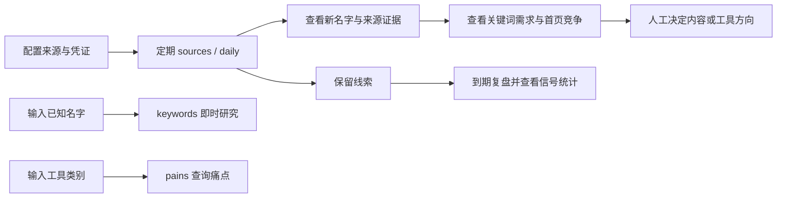

# 新词雷达产品需求文档（PRD）

版本：文档 1.0 / 产品 0.4.0；状态：现有实现基线；日期：2026-10-16。
仓库：CaryLabs/new-term-radar；代码基线：`e2d33c335b7aface39e6c0eed29e61df5b5ff684`。
配套：[架构设计](../architecture/ARCHITECTURE.md)、[逐项证据与验收](../architecture/TRACEABILITY.md)。

## 1. 产品定位与问题

新词雷达帮助围绕 AI 产品、模型、工具和开源仓库做内容或小工具的人，发现刚出现的名字，再识别这些名字背后的通用搜索需求。输出是供人工判断的研究线索与关键词表。

用户面临三个问题：传统搜索量数据可能尚未覆盖新名字；公告热度不能直接说明用户在做什么；有需求也未必有进入搜索结果首页的机会。因此产品分开呈现“发现证据、需求与走势、竞争、后续复盘”。本产品不保证抢先发现、排名、营收或真实市场规模。

当前形态是本地 Python 命令行程序，可由外部定时任务运行，可通过 Agent Skills 和 stdio MCP 被调用。没有 Web 控制台、账号体系、多租户、团队协作或在线付费系统。名字、话题与来源默认围绕 AI 领域，提取规则偏向英文及字母数字名称；中文报告不等于完整的中文关键词识别能力。

## 2. 用户与任务

| 角色 | 任务 | 产品交付 |
|---|---|---|
| AI 工具站 / SEO 运营者 | 决定今天优先研究哪个新名字、哪个通用词 | 带证据的线索及 prioritize/watch/skip 表 |
| Newsletter、导航站编辑 | 查找刚出现的模型、产品、仓库 | 来源、原文/链接、仓库增星与新增页面 |
| 独立开发者 | 从求助、教程和差评寻找工具缺口 | Reddit 求助、教程观众需求、pains 聚类 |
| 项目维护者 / Agent 使用者 | 定时运行、查询历史、检查发现是否有效 | 状态目录、复盘统计、CLI/MCP 结果 |

用户负责选择监控账号、sitemap、主题及已覆盖词，提供自己可用的凭证，阅读证据后决定是否行动。产品不会自动发布文章、建站、注册域名或实施关键词投放。

## 3. 范围、优先级与成功标准

下文 P0 表示支撑“发现 → 判断 → 报告 → 复盘”闭环的现有核心能力，P1 表示可选增强能力；这是文档中的能力分级，不是新版本开发承诺。

验收采用可观察行为：输入与阈值明确、来源和估算可识别、失败有可定位信息、保留历史可查询、相同词可以合并并复盘。现有代码只提供按信号的命中数、检查数、提前天数中位数与待复盘数，没有用户增长、收益归因或业务目标值。本轮不人为设定这些指标。

## 4. 用户主流程

- 首次使用：编辑配置，先运行一次建立来源基线。X、HF、sitemap 首次主要建快照；GitHub 爆发及符合条件的周信号仍可能有结果。首次结果少不能解释为市场平静。
- 常规运行：`sources` 高频发现 X/HF；`daily --skip x,hf` 汇总其他信号，并读取库中的近期 X/HF 线索。也可一天只运行一次完整 `daily`。
- 按需研究：已知名字直接使用 `keywords`，最多处理去重后的前 8 个名字，不必先跑全量采集；同一名字再次请求会再次查询。
- 痛点研究：`pains` 将一个类别下的评论与求助聚为缺口，次数是样本中的引用条目数，不是市场规模。
- 后续复盘：由以后的 `daily` 运行检查到期线索；没有运行就不会自动推进。

## 5. 功能需求与规则

### F01 来源与运行配置（P0）

用户可配置 X 账号、sitemap、主题正则、已覆盖词、停用词、模型及各信号阈值。默认读取当前工作目录 `config.json`，缺失即退出并提示从示例复制；`leads` 不要求配置，`mcp` 走专用入口。

配置采用顶层默认值与一级字典浅合并，未知顶层项不参与构建；没有完整 schema 校验。密钥从环境或专用凭证文件读取。语言以 `zh` 开头为中文，其他值使用英文。`known_terms` 用小写字符串双向包含判断覆盖，既可能匹配完整名字也可能误匹配短词；标记覆盖不等于从报告隐藏。

验收：缺失配置有明确退出；有效配置按默认值补全；无 GSC site 时关闭 GSC；未知 `--skip` 返回参数错误。非法类型/范围并非全部有友好校验。

### F02 高频新名字发现（P0）

**X**：抓取配置中去重账号的最近推文，在取回数据中检查最近 30 小时，排除 `RT @` 转推；相对于本地最近 60 天观测词表找新名字，不是远程历史全量检索。首次只建词表。至少两个账号使用，或单账号有强名称特征且遍历时首次遇到该名称的帖子至少 100 赞，才可入候选。同账号后续帖子不累加点赞，也不改取最高赞帖；例如先遇到 20 赞再遇到 500 赞，不能靠后者过门槛。单账号同一帖子最多保留三个名称；去嵌套后最多 25 行。

**HF**：分别抓模型和 Spaces 热门前 100 项，检测当前前 50 项中未出现在上次前 100 项的 ID。按规则去除量化、体积、微调等后缀，模型与 demo 同名时合并例子，最多 25 行。首次分别保存两个列表，不为该列表报新词。

验收：旧词、旧帖和转推不重复触发；强单源名称与双账号名称可触发；HF 基础名称与 demo 可以合并。免费 HF 路径不要求 AIsa key。

### F03 GitHub 爆发仓库（P0）

搜索默认最近 14 天创建且至少 300 星的仓库，最多两页、每页 100。仓库满足“星数 / max(存活天数, 1) ≥ 200”或“相比上次快照增星 ≥ 400”之一即触发，排序后最多 15 个。增量参照上次成功快照，未必恰好是昨天。

首次触发的仓库产生线索；已触发仓库在 30 天标记窗口内继续列于仓库表但不重复发线索。搜索变体包括仓库名、作者账号加仓库名、符合条件的作者显示名首词加仓库名。

验收：首次无历史快照也可按平均增星触发；有历史时可按增量触发。作者资料读取发生 `OSError`（含常见 HTTP/网络错误）时回退为空显示名；JSON 解析或响应结构异常仍可使整个 breakout 块失败。此时星数和 flagged 快照可能已保存，重跑不保证补回首次线索。token 可选，仅影响访问能力与限额。

### F04 竞品新增页面与新站（P0 / 周信号 P1）

- sitemap：逐站与上次 URL 快照比较；支持子 sitemap 正则选择、gzip 和 locale 前缀去重。把新增 URL 的路径切词，以不同 URL 为来源计数，至少 3 个新增 URL 包含该词；相对旧 URL 的频率排序取前 25。这里是相对排序，不存在额外的“lift 必须大于某值”过滤。首次建快照不报新增。
- 新站：默认周一或 `--new-sites` 运行；把“注册时间和数据商首次发现时间均晚于最近 90 天边界”的条件发给数据商，并在本地检查估算自然流量 **大于** 1000、排名词数至少 20。每查询最多 30 项；同域名只首次产生词线索。日期过滤依赖上游执行，不是本地独立验证域龄。

验收：某站抓取失败或空 URL 集合时保留其旧快照，其他站继续；多语言 URL 能按配置归一。用户需自行选择允许访问的站点与请求间隔；程序没有自动执行 robots 许可检查。

### F05 收入、Reddit 求助与教程需求（P1）

| 能力 | 默认运行及门槛 | 输出与边界 |
|---|---|---|
| 收入信号 | 周一或 `--revenue`；需 TRUSTMRR_API_KEY；默认增长榜和最新榜各最多 3 页，每页 10 项 | 近 30 天收入至少 500 美元的新产品，或上次为 0 本次跨门槛的产品；排除隐藏/无网站/匿名产品；最多 10 条。此前见过但非从 0 跨门槛的产品不重复产线索 |
| Reddit asks | 周一或 `--asks`；默认 12 个检索模式、week、每模式最多 25、帖子分数至少 2 | 模型保留 AI 可处理的 request/complaint，转成 2–6 词任务；月搜至少 50 的前 12 条可查竞争、首次任务生成候选；低搜索量任务另列为点子 |
| 教程需求 | daily 中最多 3 条带 one_click 标记的线索，需 GoAnyAPI 找视频 | 读取教程视频评论再归类需求，不自动写入线索库；缺 GoAnyAPI 时可能为空且无专门错误提示 |

收入介绍可作为关键词研究证据。asks 的任务短语还会经过统一名称判断，故“进入 asks 表”不等于“进入最终 leads 库”。数据源使用限制沿用仓库中的私人研究要求；本轮不提供第三方条款现时有效性的法律判断，不复制真实收入清单。

### F06 合并、评分、覆盖标记与线索保留（P0）

以采集器产出的 `term` 精确字符串合并来源、例子、帖子、变体；并非语义实体消歧。模型每批最多 25 个候选，给名称概率分。默认分数门槛 0.5；缺分候选仍可通过名称过滤。排序顺序：过名称门槛 → 来源数量 → 最早信号类别 → 媒体格式（视频/语音/图片/文本）→ 名称得分。

名称候选前 20 条展示；入库为这前 20 条中未被 `known_terms` 覆盖者，不会删除已覆盖行后再补足 20 条。低分普通词最多另列 15 条。存库按词合并，不形成每次运行的独立事件历史。

媒体格式和 one_click 为关键词规则推断。one_click 要求至少 1000 赞的帖子含教程或热梗标记，不能据此保证“一键产品尚不存在”。用户应回看原帖。评分失败不拦住报告，也不等于低质量词已被排除。

### F07 从名字研究关键词（P0）

daily 自动选名字时，要求来源含 x/hf/breakout/newsite/revenue 之一，且名称分数缺失或至少 0.8。不把所有 sitemap/asks 任务自动当成产品名。默认每次 daily 的关键词研究步骤最多处理 5 个，优先新名字，再处理首次读取至少 3 天且只读过一次的名字。`per_day` 是每次调用上限，没有每日总额计数；同一天重复运行可继续处理更多名字。状态保留 30 天；不保证恰好第三天处理，也不保证一个名字永远只读两次。

研究步骤：

1. 逐名字搜最近 14 天的高赞 X 证据；有 repo 时读最多 3000 字符 README，收入介绍可补位。帖子最多保留 12 个。
2. 模型提取用途，解析后保留 2–5 词、最多 6 个通用词；包含原名的短语、重复和超长短语排除。
3. 可选相关查询分为原名长尾、通用候选、其他上升名字；相关性筛选至少 0.6，排除被识别为其他名字的通用候选。筛选调用失败时原候选可保留，不能当作已通过相关性核验。
4. 批量查通用词月搜索量；至少 50 的按量排序，最多 10 个进入趋势表。名字行仍保留，不要求先有月搜。
5. 获取单词走势与对基准词 `gpts` 的相对量；可选国家走势与首页竞争；为每行给出研究建议。

`keywords` 对显式名字即时研究，去重后最多前 8 个；不受 daily 的 per_day/二次读取记录约束，也不更新该记录或 leads 数据库。竞争评分缓存仍可能写盘。不能把按需查询描述为完全无副作用。

### F08 趋势、规模与建议（P0）

| 字段 / 判断 | 现状含义 |
|---|---|
| 全球走势 | 查约 90 天；仅用日期早于 today−2 的点，归一到 0–100；以最后保留点日期 end 为锚，end−30 日至 end（两端包含）内至少 2 个点达到 max(基线×2, 基线+10) 算上涨，基线为该窗口之前的保留点均值 |
| 国家走势 | 有 key 且开启时，每个名字及月搜至少 1000 的通用词（通用词最多 8 行）；约 30 天、丢当日；以最后保留点日期 end 为锚，end−10 日至 end（两端包含）内至少 3 个点达到 max(基线×1.5, 基线+10) 算上涨，基线为该窗口之前的保留点均值 |
| 是否新词 | 已上涨且基线 <10；不是全网首次出现证明 |
| 开始上涨 | 从窗口内峰值向前连续过阈值的一段起点；上涨判定本身按点数，不要求这些点连续 |
| now | 无上涨为 flat；end−峰值日 <3 天为 rising；否则日期 >end−3 日的保留点最高值至少峰值一半为 holding，其余 fading |
| momentum | 最后 7 个已保留点均值 / 紧邻其前的 7 点均值；前段均值 <5 时缺省，避免近零放大 |
| 估算日搜 | 优先由自身月搜/30×近期趋势与月度锚点的比值估计；否则用与基准词的相对走势及校准规模；锚点不足时可以为空 |

这些窗口相对最后一个保留点，不是运行当天；实现没有校验数据新鲜度、排序或日期连续性，而是假定输入按日有序。旧序列若末端上涨，今天运行仍可能显示 `rising`；缺日时按已有点数判断，不能把该状态当成实时热度证明。国家数据替代的是走势形状，日搜仍从全球序列和月搜估算；它们并非同一地域口径。国家系列为空/全零可回退全球，未必都有错误标记。`flat` 表示在本次可用数据中未检测到上涨，不等于现实需求没变。

建议规则：走势无可用数据（no_data）→ watch；fading → skip；flat 且估算日搜至少 300 → watch，日搜低于门槛或缺失 → skip；rising/holding 且日搜至少 300 → prioritize，否则 watch。日搜缺失在门槛判断中视为未达标，展示时仍保留缺失状态，不代表真实搜索量为 0。搜索量是估算，没有生产准确率承诺。

### F09 搜索首页竞争（P1）

默认对 prioritize 优先、watch 随后的前 8 行读取搜索首页、关键词难度 KD，可选域名评分 DR、当月标题页面数和广告主。弱站指 DR <30；统计的是结果条目，不保证独立域名数。DR 缓存 30 天。

- open：弱结果至少 3 个，**或**已知 KD <20。
- crowded：弱结果为 0 **或未知**，**且** KD ≥40 **或未知**。
- 其他为 mixed。crowded 的 prioritize 降为 watch，并标 demoted。

特别注意：DR 和 KD 都缺失也可能判 crowded，不能把它解释为“已经证明首页全是强站”。SERP 调用异常可能跳过该行竞争；结果为空但未抛异常则仍可能产生竞争判断。广告与已有页面是补充证据，不单独决定建议。

### F10 自有站首次曝光（P1）

GSC 没有 site 时关闭；有 site 时读取截至昨天最近 3 天、并对比此前 60 天的查询。合并 query/page 曝光与点击，仅列此前窗口未见、近期累计曝光至少 5 的前 30 个查询，过滤搜索操作符。单次查询上限 25000 行，没有翻页全量保证。

GSC 结果单独进入日报与主题节，不进入统一名称线索库、自动关键词研究或 14 天复盘。“首次曝光”仅指这些被查询窗口内首次见到，并非网站终身首次。

### F11 历史与 14 天复盘（P0）

每次 daily 默认取首次记录至少 14 天、`reviewed_at` 为空的最早 5 个词。每词最多取前三个搜索变体，分别对其自身基线查 Trends；在起始日前 30 天到起始日后 14 天的窗口读取，剔除未结算尾部。

任一变体在首次记录后峰值至少达到 max(前期均值×2, 前期均值+10) 为 hit；全部无数据为 no_data；其余 miss。此处是峰值判定，没有 F08 的多日持续门槛。调用结果缺少 call_id 时该词保持待复盘；收到结果但序列空时可终结为 no_data，不会自动重试该结论。

提前天数 = 被判上涨的最早起点日 − first_seen；起点查找可能落在 first_seen 之前，允许负数，不应解释为总是提前发现。已有结论的词再次出现不会自动重新复盘。

`leads --days N` 按 last_seen 日期查询历史，默认 7，返回 verdict 和 days_ahead；无库时会创建空库。汇总使用最近 60 天的 reviewed_at，每个词对其所有来源各贡献一次 checked，no_data 也在 checked 分母内；hit/checked 是此定义下的比例，多来源结果不能加总为去重线索数。pending 是全库未复盘数。

### F12 痛点研究（P1）

`pains "工具类别"` 汇集 Chrome 低星评价、Reddit 帖子和 YouTube 教程评论；可指定扩展 ID，默认扩展最多 5 个、每个最多 2 页、星级至多 3、教程视频最多 3 个。模型最多处理前 120 条样本，归为 missing / too hard / quality / price / wants a tool，并给出次数、搜索短语、来源和最多两条例子。

总 items 可以大于模型处理样本数；组内 count 是模型返回的有效引用索引数，未保证去重或统计代表性。该命令不写 leads、不走机会表规模决策、不直接暴露为 MCP 工具。无 GoAnyAPI 时 Chrome 默认跳过，视频搜索也无法执行；显式扩展 ID 不替代服务凭证。

### F13 报告、语言与邮件（P0 / 邮件 P1）

- `daily --out report.md` 写 Markdown 及同名 `.json`（leads、各采集块、gsc、review、summary、keywords）。JSON 不包含所有 `extra`，例如教程与 recent_sources 没有独立顶层输出。
- `sources` 有通过名称过滤的候选或检测到块/评分/记录错误时才生成报告；否则只输出安静状态，不会删除旧报告文件。仅首次快照或无新词也不保证写状态报告。
- `keywords`、`pains` 支持 `--json` 和 `--out`；`leads --json` 写标准输出，当前 `leads` 路径忽略 `--out`。
- `--mail` 仅在 sources/daily 的完成路径发送；收件人未设时跳过，地址非法或发送失败可能使进程失败，但此前状态/报告不回滚。需要可选 markdown 依赖。
- 报告中错误、skipped、off、no_key 和空结果含义不同。daily 在单源失败后通常继续并返回 0；配置、数据库连接、报告渲染、文件写入和邮件等错误仍可终止整个命令。退出码 0 不是数据完整性证明。

### F14 Agent Skills 与 MCP（P1）

仓库带三个 Skill：new-term-radar 完整闭环、ai-listening 采集、seo-new-keywords-research 按名研究。它们是引导 Agent 使用同一 CLI 的说明，不是另一个常驻执行引擎。

stdio MCP 提供 recent_leads、keyword_table、run_radar 三个工具。recent_leads 查本地库；keyword_table 返回表、rows、有限范围的 incomplete 和 cost_usd；run_radar 仅允许 sources/daily，返回 Markdown 与 wrote_report。需安装 MCP 依赖，通过 RADAR_CONFIG/RADAR_STATE 定位同一配置/状态。

MCP 没有 HTTP 服务、用户鉴权层、定时器或任务取消/回滚协议；付费工具运行时间较长。incomplete 只聚合部分错误字段，不能视为全链路健康状态。详见架构契约与并发限制。

## 6. 非功能边界

| 方面 | 当前能力 / 限制 | 验收口径 |
|---|---|---|
| 可运行性 | Python ≥3.10；核心标准库，邮件/MCP 可选依赖 | 使用仓库入口和可用环境验证；Windows 推荐 UTF-8 模式 |
| 时间与调度 | 外部调度；程序多数按宿主 date.today，X 按 UTC 时间筛帖 | 必须声明运行时区，不把日期查询说成严格滚动 24 小时 |
| 失败隔离 | 单信号封装异常；部分可选数据降级 | 确认报告中的失败信息；不承诺整次事务一致性 |
| 可解释性 | 来源、例子、品牌/相关搜索/地域标记 | 读者可回到证据；模型输出非事实证明 |
| 费用 | 返回 data cost 微美元，chat token 费用未汇总；失败批次可能漏记 | 不承诺固定每日/月预算，不以报告金额代替账单 |
| 状态持久性 | 本地 SQLite + gzip JSON；Actions 使用 cache | 自行备份整个 state，缓存命中不等于持久备份 |
| 安全 | 凭证不在常规 config；部分敏感路径 gitignore | 报告/快照可能含原文，日志错误可能带上游内容；不能承诺自动脱敏 |
| 并发 | 单流程同步编排，局部线程请求；无跨进程锁 | 同一 state 应单写者串行运行；多用户共享不是已支持场景 |

## 7. 验收与后续决策

功能验收及未覆盖项逐项见[追溯矩阵](../architecture/TRACEABILITY.md)。所有测试均为现有测试；没有为本文档修改断言、模型规则或业务逻辑。

后续事项（未承诺实现）：外部接入与数据质量验收、状态恢复与并发评估、Windows 运行保障、发布命名空间归属核验。owner 均为项目维护者，应作为独立 work unit 决策，不能据此把当前产品描述为具备高可用或多租户能力。
